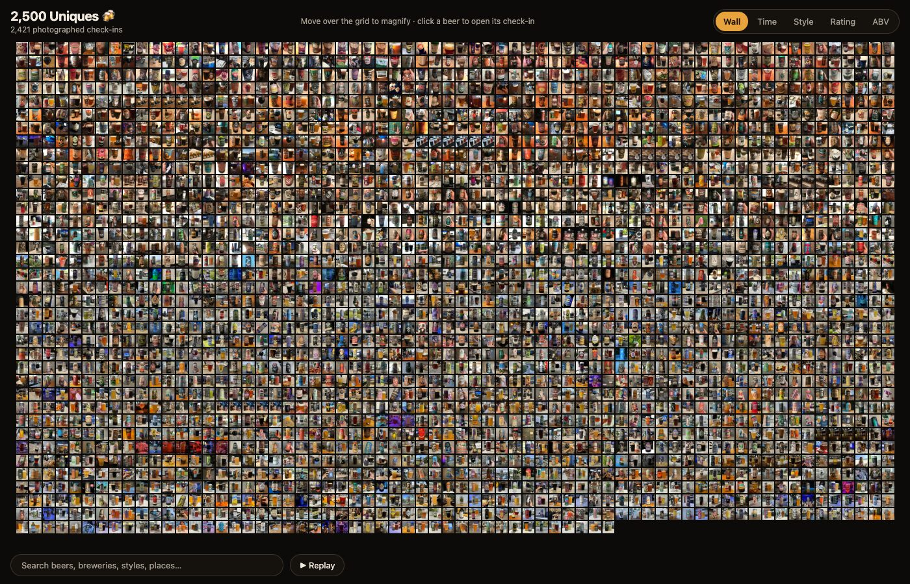

# Untappd Photo Wall

A single page that turns your Untappd check-in photos into one big mosaic. Move the pointer over it and a fisheye lens magnifies the tiles under it; click a beer to open its check-in. Regroup the whole wall by time, style, rating or ABV, search it, or replay your history from the first pint.

**Live example:** [static.jasongraphix.com/untappd](https://static.jasongraphix.com/untappd)



It's a static site. There's no server, no framework and no build step for the page itself: a couple of Python scripts turn your export into thumbnails and a data file, and the result drops onto any web host.

*Shared as is, for fun. It's a hobby project, so don't expect support.*

## What you need

- **An Untappd data export.** Untappd offers CSV and JSON exports to paid subscribers (account settings, "Export Data"). Either works.
- **Python 3.9+** (standard library only).
- **[ImageMagick](https://imagemagick.org)** with WebP support, for thumbnails (`brew install imagemagick` on macOS).

## Build it

Put your export in this folder (any file name; it's found by content), then:

```bash
python3 scripts/download_photos.py   # fetches your check-in photos into originals/
python3 scripts/build_assets.py      # thumbnails, sprite sheets, site/data/beers.json
python3 -m http.server 8000 --directory site
```

Open http://localhost:8000.

Both scripts can be re-run any time. Photos and thumbnails that already exist are skipped, so after a fresh export only the new check-ins are processed.

If you keep more than one export in the folder, the newest wins. To choose one, pass its path: `python3 scripts/build_assets.py path/to/export.json`.

## Deploy it

Upload the contents of `site/` to any static host. That's all of it. Everything uses relative paths, so it works in a subfolder. `originals/`, `build/` and your export never need to leave your machine.

A re-upload after adding new check-ins takes effect immediately: the page appends a version to its sprite sheets, which changes whenever the set of photos does.

## Settings

`config.json` holds the page title:

```json
{ "title": "My Beer Wall" }
```

Anything in `config.local.json` (git-ignored) overrides it, so your own settings stay out of the repo. Re-run `build_assets.py` after changing either file.

## Embedding

Add `?embed=1` to the URL for a compact version that suits an iframe in a blog post: no title, search or replay, a smaller lens, a link to open the full page, and vertical swipes still scroll the page on a phone.

```html
<iframe src="https://example.com/beer/?embed=1" width="100%" height="560"
        style="border:none" loading="lazy" title="My Untappd photo wall"></iframe>
```

Your host must not send `X-Frame-Options: DENY` or `SAMEORIGIN` for the page, or a browser will refuse to show it in an iframe on another site.

## How it works

- `scripts/checkins.py` reads the CSV or JSON export and gives back the same rows either way.
- `scripts/download_photos.py` downloads each check-in photo from Untappd's image host.
- `scripts/build_assets.py` makes 64px tiles packed into sprite sheets (two images for about 2,400 photos), a 360px image per check-in that loads on hover, and a slim `beers.json`.
- `site/index.html` draws every tile to one canvas and does the lens, layouts, search and replay in plain JavaScript.

## Privacy

Your export contains private data: comments, venues, and the names of friends you tagged. The `.gitignore` keeps the export, the downloaded photos and everything generated from them out of the repo. The generated `site/data/beers.json` includes beer names, ratings, dates, venue names and **your comments**, and it's public once you upload the site, so read through it first. Tagged friends' names and venue coordinates are not included.

The photos come from your own check-ins, using your own export. This isn't affiliated with Untappd; check their terms before pointing the downloader at anything you didn't export yourself.

## License

MIT, see [LICENSE](LICENSE).
