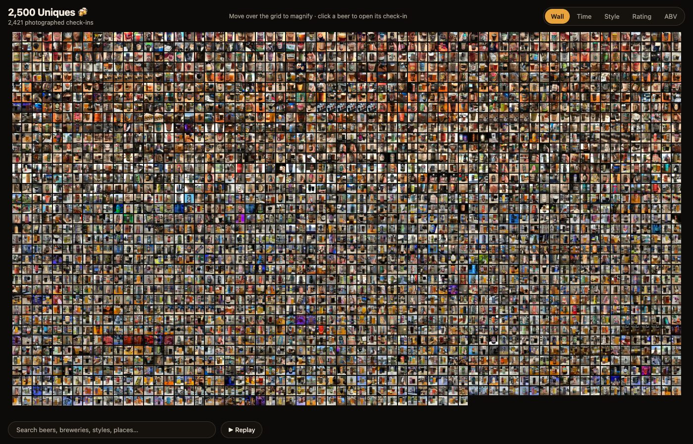

# Untappd Photo Wall

A single page that turns your Untappd check-in photos into one big mosaic. Move the pointer over it and a fisheye lens magnifies the tiles under it; click a beer to open its check-in. Regroup the whole wall by time, style, rating or ABV, search it, or replay your history from the first pint.

**Live example:** [static.jasongraphix.com/untappd](https://static.jasongraphix.com/untappd)



It's a static site. There's no server and no framework: a couple of Python scripts turn your export into thumbnails and a data file, and the result drops onto any web host.

*Shared as is, for fun. It's a hobby project, so don't expect support.*

## What you need

- **An Untappd data export.** Untappd offers CSV and JSON exports to paid subscribers (your account settings, "Export Data"). Either format works, and you only need a subscription for long enough to export.
- **Python 3.9 or newer.** On a Mac, run `python3 --version` in Terminal to see if you have it; if not, install it from [python.org](https://www.python.org/downloads/). On Windows, install it from python.org and **tick "Add python.exe to PATH"** on the first screen of the installer.
- **[ImageMagick](https://imagemagick.org)**, a free tool that makes the thumbnails. On a Mac with [Homebrew](https://brew.sh): `brew install imagemagick`. On Windows, run `winget install ImageMagick.ImageMagick` or use the installer from imagemagick.org and leave "Add application directory to your system path" ticked.

## Build it

1. **Get the project.** On this page click the green **Code** button, choose **Download ZIP**, and unzip it somewhere you'll find it (or `git clone` it if you know how).
2. **Add your export.** Put the CSV or JSON file you got from Untappd in the unzipped folder, next to this README. Any file name is fine; it's recognized by what's inside.
3. **Open a terminal in that folder.**
   - **Mac:** open Terminal, type `cd ` (with a space), drag the folder onto the window, and press Return.
   - **Windows:** open the folder in File Explorer, click the address bar, type `cmd` and press Enter.
4. **Run the two scripts.** On Windows use `python` instead of `python3`.

   ```bash
   python3 scripts/download_photos.py   # downloads your check-in photos into originals/
   python3 scripts/build_assets.py      # makes thumbnails and the data the page needs
   ```

   The first run takes a few minutes, depending on how many photos you have. If it stops partway, just run it again; it picks up where it left off.

That's it. Everything the site needs is now in the `site/` folder.

Both scripts can be re-run any time. Photos and thumbnails that already exist are skipped, so after a fresh export only the new check-ins are processed. 

## See it

Opening `site/index.html` by double-clicking won't work, because browsers block a page from loading its own data files that way. To view your site, you can either:

**Option A: View it on your own computer.** In the same terminal window, run this (again, `python` on Windows):

```bash
python3 -m http.server 8000 --directory site
```

Then open http://localhost:8000 in your browser. Press Ctrl+C in the terminal to stop it.

**Option B: Put it on a server.** Upload the contents of `site/` to any web host that serves plain HTML files. You can use FTP, SFTP or your host's file manager (Cyberduck and FileZilla are free). 

When you add new photo check-ins later, export again, re-run the two scripts, and upload your `site/` folder again. 

## Something went wrong?

- **"ImageMagick isn't installed" or "'magick' was not found."** Install ImageMagick (above), then close the terminal and open a new one so it can see the new program.
- **"python3 is not recognized" (Windows).** Use `python` instead, or `py`. If neither works, reinstall Python and tick "Add python.exe to PATH".
- **The page is blank or says it can't load data.** Use Option A or B above rather than opening the file directly, and make sure `build_assets.py` finished without errors.
- **Some photos are missing.** Re-run `download_photos.py`. It lists any it couldn't fetch at the end, and a re-run retries them.

## Settings

`config.json` only has one option, to set the page title:

```json
{ "title": "My Beer Wall" }
```

Anything in `config.local.json` (git-ignored) overrides it, so your own settings stay out of the repo. Re-run `build_assets.py` after changing either file.

## Embedding

Add `?embed=1` to the URL for a compact version that suits an iframe in a blog post: no title, a smaller lens, everything fitted to the frame instead of scrolling, a link to open the full page, and vertical swipes still scroll the page on a phone.

```html
<iframe src="https://example.com/beer/?embed=1" width="100%" height="700"
        style="border:none" loading="lazy" title="My Untappd photo wall"></iframe>
```

## How it works

- `scripts/checkins.py` reads the CSV or JSON export
- `scripts/download_photos.py` downloads each check-in photo from Untappd
- `scripts/build_assets.py` makes 64px photo sprite sheets and a 360px copy of each image that loads on hover, along with the `beers.json` file with all the image details
- `site/index.html` draws every tile to one canvas and handles the lens, layouts, search and replay with JavaScript.

## Privacy

Your export contains private data: comments, venues, and the names of friends you tagged. The `.gitignore` keeps the export, the downloaded photos and everything generated from them out of the repo. The generated `site/data/beers.json` includes beer names, ratings, dates, venue names and **your comments**, and it's public once you upload the site, so read through it first. Tagged friends' names and venue coordinates are not included.

The photos come from your own check-ins, using your own export. This isn't affiliated with Untappd; check their terms before pointing the downloader at anything you didn't export yourself.

## License

MIT, see [LICENSE](LICENSE).
